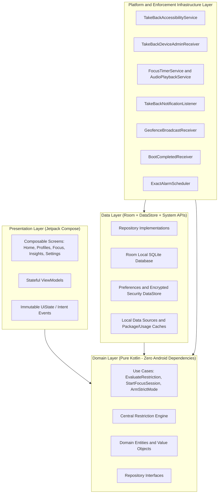

# System Architecture & Clean Modularity

## 1. Architectural Style & Layering

**TakeBack** is engineered according to **Clean Architecture** principles and the standard Android architecture guidelines, leveraging unidirectional data flow (UDF) and reactive state management.



---

## 2. Layer Responsibilities & Invariants

### 1. Presentation Layer (`com.vr.takeback.presentation`)
- **UI Framework:** 100% Jetpack Compose with Material 3.
- **State Pattern:** MVI / MVVM with unidirectional data flow. ViewModels expose a single `StateFlow<UiState>` and accept a sealed class of `UiEvent` user actions.
- **Invariant:** Presentation components never access Room DAOs or system services directly; all operations flow through domain Use Cases.

### 2. Domain Layer (`com.vr.takeback.domain`)
- **Technology:** Pure Kotlin standard library.
- **Components:**
  - `CentralRestrictionEngine`: The pure state evaluation machine.
  - Domain Entities: `Profile`, `RestrictionRule`, `Schedule`, `UsageQuota`, `FocusSession`, `StrictModeConfig`.
  - Use Cases: `EvaluateAppAccessUseCase`, `GetUsageAnalyticsUseCase`, `ToggleProfileUseCase`, `VerifyChallengeUseCase`.
- **Invariant:** Absolute independence from Android framework classes (`android.*`), enabling fast, deterministic JUnit tests without Robolectric.

### 3. Data Layer (`com.vr.takeback.data`)
- **Storage:** Room Database (`TakeBackDatabase`) for complex relational entities; Jetpack DataStore / `EncryptedSharedPreferences` for settings and secure credentials.
- **Repositories:** `ProfileRepositoryImpl`, `UsageAnalyticsRepositoryImpl`, `RestrictionRepositoryImpl`, `SoundRepositoryImpl`.
- **Offline Guarantee:** 100% local persistence. No cloud API endpoints or remote network clients.

### 4. Platform & System Services Layer (`com.vr.takeback.platform`)
- **Background Execution:**
  - `TakeBackAccessibilityService`: Fast window-state observer and browser URL extractor.
  - `TakeBackDeviceAdminReceiver`: Standard Device Administrator protection against unauthorized deactivation.
  - `FocusTimerForegroundService`: Keeps Pomodoro timer and audio playback resilient against OS termination.
  - `TakeBackNotificationListener`: Manages distraction suppression.
  - `ExactAlarmScheduler`: Registers wakeup alarms via `AlarmManager.setAlarmClock()`.

---

## 3. Dependency Injection Architecture (Hilt)

The application uses **Dagger-Hilt** for compile-time dependency injection across structured scopes:
- `@Singleton`: `TakeBackDatabase`, `CentralRestrictionEngine`, `DataStoreManager`, `UsageStatsHelper`.
- `@ViewModelScoped`: ViewModels injecting specific Use Cases.
- `@ServiceScoped`: Foreground and Accessibility services injecting the Restriction Engine and Repositories.

---

## 4. Future Cross-Platform (iOS) Abstraction

To ensure seamless future development of an iOS counterpart without redesigning core concepts, platform-specific enforcement capabilities are cleanly decoupled behind interfaces:

```kotlin
interface AppUsageTracker {
    suspend fun getDailyUsage(packageName: String, date: LocalDate): Duration
    fun observeForegroundApp(): Flow<String?>
}

interface WebContentFilter {
    fun setBlockedDomains(domains: Set<String>)
    fun setBlockedKeywords(keywords: Set<String>)
}

interface ShieldDisplayManager {
    fun showBlockShield(decision: BlockDecision.Blocked)
    fun dismissBlockShield()
}
```

On Android, these interfaces bind to `UsageStatsManager`, `LocalDnsVpnService`, and `BlockShieldActivity`. On iOS, a future module will bind them to `FamilyControls`, `ManagedSettingsStore`, and `DeviceActivityReport`.
