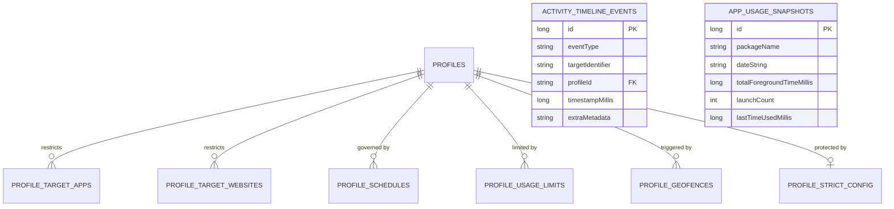

# Database Schema & Entity Relational Design

## 1. Schema Overview & Relational Architecture

**TakeBack** utilizes Android Room (SQLite) for structured local storage. The schema is organized around a central `ProfileEntity` with relational tables representing specific blocking constraints, schedules, and historical analytics.



---

## 2. Table Definitions & Room Entities

### Table 1: `profiles`
The primary entity representing a user restriction profile.
```sql
CREATE TABLE IF NOT EXISTS `profiles` (
    `id` TEXT NOT NULL PRIMARY KEY,
    `name` TEXT NOT NULL,
    `icon_name` TEXT NOT NULL,
    `color_hex` TEXT NOT NULL,
    `is_enabled` INTEGER NOT NULL DEFAULT 1,
    `is_preset` INTEGER NOT NULL DEFAULT 0,
    `created_at_millis` INTEGER NOT NULL,
    `updated_at_millis` INTEGER NOT NULL
);
```

### Table 2: `profile_target_apps`
Junction table linking restricted or whitelisted applications to a profile.
```sql
CREATE TABLE IF NOT EXISTS `profile_target_apps` (
    `id` INTEGER PRIMARY KEY AUTOINCREMENT NOT NULL,
    `profile_id` TEXT NOT NULL,
    `package_name` TEXT NOT NULL,
    `app_name` TEXT NOT NULL,
    `is_allowlist` INTEGER NOT NULL DEFAULT 0,
    FOREIGN KEY (`profile_id`) REFERENCES `profiles`(`id`) ON DELETE CASCADE
);
CREATE INDEX IF NOT EXISTS `index_profile_target_apps_profile_id` ON `profile_target_apps`(`profile_id`);
CREATE INDEX IF NOT EXISTS `index_profile_target_apps_package_name` ON `profile_target_apps`(`package_name`);
```

### Table 3: `profile_target_websites`
Blocked domains, wildcard expressions, and keywords per profile.
```sql
CREATE TABLE IF NOT EXISTS `profile_target_websites` (
    `id` INTEGER PRIMARY KEY AUTOINCREMENT NOT NULL,
    `profile_id` TEXT NOT NULL,
    `domain_pattern` TEXT NOT NULL,
    `rule_type` TEXT NOT NULL, -- 'EXACT_DOMAIN', 'WILDCARD', 'KEYWORD'
    `is_allowlist` INTEGER NOT NULL DEFAULT 0,
    FOREIGN KEY (`profile_id`) REFERENCES `profiles`(`id`) ON DELETE CASCADE
);
CREATE INDEX IF NOT EXISTS `index_profile_target_websites_profile_id` ON `profile_target_websites`(`profile_id`);
```

### Table 4: `profile_schedules`
Recurring weekly or daily time schedules.
```sql
CREATE TABLE IF NOT EXISTS `profile_schedules` (
    `id` INTEGER PRIMARY KEY AUTOINCREMENT NOT NULL,
    `profile_id` TEXT NOT NULL,
    `days_of_week_mask` INTEGER NOT NULL, -- Bitmask: 1=Mon, 2=Tue, 4=Wed, 8=Thu, 16=Fri, 32=Sat, 64=Sun
    `start_time_seconds` INTEGER NOT NULL, -- Seconds from midnight (0 to 86399)
    `end_time_seconds` INTEGER NOT NULL,   -- Seconds from midnight (0 to 86399)
    `is_enabled` INTEGER NOT NULL DEFAULT 1,
    FOREIGN KEY (`profile_id`) REFERENCES `profiles`(`id`) ON DELETE CASCADE
);
CREATE INDEX IF NOT EXISTS `index_profile_schedules_profile_id` ON `profile_schedules`(`profile_id`);
```

### Table 5: `profile_usage_limits`
Daily quotas and sliding hourly limits.
```sql
CREATE TABLE IF NOT EXISTS `profile_usage_limits` (
    `id` INTEGER PRIMARY KEY AUTOINCREMENT NOT NULL,
    `profile_id` TEXT NOT NULL,
    `target_package_name` TEXT, -- NULL denotes shared pool limit for all profile apps
    `daily_limit_minutes` INTEGER NOT NULL,
    `window_type` TEXT NOT NULL, -- 'FULL_DAY', 'PER_HOUR', 'PER_SESSION'
    `is_enabled` INTEGER NOT NULL DEFAULT 1,
    FOREIGN KEY (`profile_id`) REFERENCES `profiles`(`id`) ON DELETE CASCADE
);
CREATE INDEX IF NOT EXISTS `index_profile_usage_limits_profile_id` ON `profile_usage_limits`(`profile_id`);
```

### Table 6: `profile_geofences`
Location triggers mapped to profiles.
```sql
CREATE TABLE IF NOT EXISTS `profile_geofences` (
    `id` TEXT NOT NULL PRIMARY KEY,
    `profile_id` TEXT NOT NULL,
    `name` TEXT NOT NULL,
    `latitude` REAL NOT NULL,
    `longitude` REAL NOT NULL,
    `radius_meters` REAL NOT NULL,
    `trigger_on_enter` INTEGER NOT NULL DEFAULT 1,
    `trigger_on_exit` INTEGER NOT NULL DEFAULT 0,
    `is_enabled` INTEGER NOT NULL DEFAULT 1,
    FOREIGN KEY (`profile_id`) REFERENCES `profiles`(`id`) ON DELETE CASCADE
);
CREATE INDEX IF NOT EXISTS `index_profile_geofences_profile_id` ON `profile_geofences`(`profile_id`);
```

### Table 7: `profile_strict_config`
Strict Mode lock parameters per profile.
```sql
CREATE TABLE IF NOT EXISTS `profile_strict_config` (
    `profile_id` TEXT NOT NULL PRIMARY KEY,
    `is_strict_active` INTEGER NOT NULL DEFAULT 0,
    `mechanism` TEXT NOT NULL, -- 'PIN', 'TIMED_LOCK', 'TEXT_CHALLENGE', 'DELAY'
    `salt_base64` TEXT,
    `password_hash` TEXT,
    `locked_until_epoch_millis` INTEGER,
    `delay_minutes` INTEGER DEFAULT 5,
    FOREIGN KEY (`profile_id`) REFERENCES `profiles`(`id`) ON DELETE CASCADE
);
```

### Table 8: `activity_timeline_events`
Local-first activity log for audit and timeline visualization.
```sql
CREATE TABLE IF NOT EXISTS `activity_timeline_events` (
    `id` INTEGER PRIMARY KEY AUTOINCREMENT NOT NULL,
    `event_type` TEXT NOT NULL,
    `target_identifier` TEXT NOT NULL,
    `profile_id` TEXT,
    `timestamp_millis` INTEGER NOT NULL,
    `extra_metadata` TEXT
);

---

## 3. Dedicated Atomic Key-Value Stores (SharedPreferences)

To guarantee that active restriction profiles, ongoing Pomodoro sprints, and strict wake-up alarms survive Android Low Memory Killer (LMK) process death and device reboots without migration friction, TakeBack maintains atomic local preference files:

### Store 1: `takeback_alarms_prefs`
- `alarms_json`: JSON-serialized array of `StrictAlarm` objects storing `id`, `hour`, `minute`, `daysOfWeekMask`, `isEnabled`, `difficulty`, and `label`.

### Store 2: `takeback_quickblock_prefs`
- `is_active` (`BOOLEAN`): Active digital detox flag.
- `duration_minutes` (`INTEGER`): Original block duration.
- `start_epoch_millis` (`LONG`): Epoch timestamp when Quick Block was initiated.
- `target_packages` (`TEXT`): Comma-separated list of restricted package names.

### Store 3: `takeback_focus_session_prefs`
- `session_id` (`TEXT`): Unique UUID for the Pomodoro session.
- `focus_duration_minutes` / `break_duration_minutes` (`INTEGER`): Configured cycle intervals.
- `total_cycles` / `current_cycle` (`INTEGER`): Cycle count tracking.
- `state` (`TEXT`): `IDLE`, `FOCUS_RUNNING`, `BREAK_RUNNING`, `PAUSED`, `COMPLETED`.
- `active_profile_id` (`TEXT`): Profile applied during the focus sprint.
- `current_period_start_epoch_millis` (`LONG`): Period start timestamp.
- `current_period_duration_millis` (`LONG`): Active period duration.
- `break_whitelist_apps` (`TEXT`): Whitelisted app packages during breaks.
- `ambient_sound_key` (`TEXT`): Selected audio soundscape key.

### Store 4: `takeback_strict_prefs`
- `is_global_strict_active` (`BOOLEAN`): Global arming flag.
- `mechanism` (`TEXT`): Verification challenge mechanism.
- `salt_base64` (`TEXT`): 128-bit CSPRNG salt.
- `password_hash` (`TEXT`): PBKDF2-HMAC-SHA256 hash.
- `temp_unlock_epoch_ms` / `temp_settings_unlock_epoch_ms` (`LONG`): Cooldown timers.

### Store 5: `takeback_essential_prefs`
- `is_enabled` (`BOOLEAN`): Essential Mode activation toggle.
- `daily_allowance_minutes` (`INTEGER`): Daily screen time threshold.
- `selected_additional_package` (`TEXT`): Single user-whitelisted productivity app.
- `custom_goodlock_modules` (`STRING_SET`): Allowlisted Samsung Good Lock package names.
    `event_type` TEXT NOT NULL, -- 'APP_OPENED', 'APP_BLOCKED', 'PROFILE_ACTIVATED', 'FOCUS_START', 'BREAK_START'
    `target_identifier` TEXT NOT NULL,
    `profile_id` TEXT,
    `timestamp_millis` INTEGER NOT NULL,
    `extra_metadata` TEXT
);
CREATE INDEX IF NOT EXISTS `index_activity_events_timestamp` ON `activity_timeline_events`(`timestamp_millis`);
```

---

## 3. Migration & Pruning Strategies

- **Automated Retention Pruning:** A periodic WorkManager task runs nightly to delete records from `activity_timeline_events` older than 30 days:
  ```sql
  DELETE FROM activity_timeline_events WHERE timestamp_millis < :thirtyDaysAgo;
  ```
- **Schema Evolution:** Room `autoMigrations` are enabled with explicit `Migration(from, to)` classes for table alterations to ensure zero user data loss across updates.
