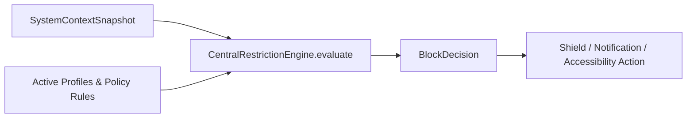
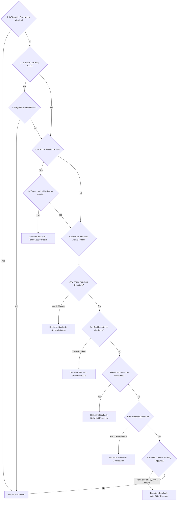

# Central Restriction Engine Specification

## 1. Architectural Philosophy & Pure Domain Design

The **Central Restriction Engine** is the single source of truth for all blocking and access control decisions in **TakeBack**. 

### Anti-Pattern Avoidance:
In legacy architectures (including many commercial competitors), individual features (schedules, daily limits, focus sessions, and geofences) each maintain disparate listeners, independent broadcast receivers, and ad-hoc blocking triggers. This results in:
- State race conditions (e.g. daily limit says allowed, but schedule says blocked).
- Zombie overlays and conflicting dismissals.
- High battery drain from redundant evaluators.
- Unpredictable behavior during multi-profile overlap.

### The Pure Evaluator Principle:
TakeBack solves this by separating **State Snapshot Aggregation** from **Policy Evaluation**. The core evaluation engine is a **pure Kotlin domain class** with zero Android framework dependencies. It accepts an immutable `SystemContextSnapshot` and returns a deterministic `BlockDecision`.



---

## 2. Data Models & Type Contracts

```kotlin
package com.vr.takeback.domain.engine

import java.time.DayOfWeek
import java.time.LocalTime

/**
 * Immutable snapshot of system environment at the moment of evaluation.
 */
data class SystemContextSnapshot(
    val timestampMillis: Long,
    val localTime: LocalTime,
    val dayOfWeek: DayOfWeek,
    val foregroundPackageName: String?,
    val activeBrowserUrl: String? = null,
    val accumulatedForegroundTimeMillis: Map<String, Long> = emptyMap(),
    val hourlyForegroundTimeMillis: Map<String, Long> = emptyMap(),
    val currentSessionDurationMillis: Long = 0L,
    val isUsageDataAvailable: Boolean = true,
    val usageDataQuality: UsageDataQuality = UsageDataQuality.RECONSTRUCTED_COMPLETE,
    val activeGeofenceIds: Set<String> = emptySet(),
    val isFocusSessionActive: Boolean = false,
    val isBreakActive: Boolean = false,
    val activeFocusSessionProfileId: String? = null,
    val breakWhitelistApps: Set<String> = emptySet(),
    val isQuickBlockActive: Boolean = false,
    val quickBlockExpirationEpochMillis: Long? = null,
    val quickBlockTargetPackages: Set<String> = emptySet(),
    val isStrictModeActive: Boolean = false,
    val strictModeExpirationMillis: Long? = null,
    val isEssentialModeActive: Boolean = false,
    val essentialModeAllowanceMinutes: Int = 0,
    val essentialModeTotalUsageMinutes: Int = 0,
    val essentialModeExemptPackages: Set<String> = emptySet()
)

/**
 * Granular, explainable decision returned by the engine.
 */
sealed class BlockDecision {
    object Allowed : BlockDecision()
    
    data class Blocked(
        val target: BlockTarget,
        val triggeringProfileId: String,
        val triggeringProfileName: String,
        val reason: BlockReason,
        val remainingDurationMillis: Long? = null,
        val allowBreakUntilMillis: Long? = null
    ) : BlockDecision()
}

sealed class BlockTarget {
    data class Application(val packageName: String) : BlockTarget()
    data class Website(val domainOrUrl: String) : BlockTarget()
    data class ContentArea(val areaType: ContentType) : BlockTarget()
}

enum class ContentType {
    YOUTUBE_SHORTS,
    INSTAGRAM_REELS,
    FACEBOOK_REELS,
    SNAPCHAT_SPOTLIGHT
}

sealed class BlockReason {
    object ScheduleActive : BlockReason()
    data class DailyLimitExceeded(val limitMinutes: Int, val usedMinutes: Int) : BlockReason()
    data class HourlyQuotaExceeded(val limitMinutes: Int) : BlockReason()
    data class SessionQuotaExceeded(val limitMinutes: Int, val usedMinutes: Int) : BlockReason()
    data class GoalNotMet(val requiredMinutes: Int, val completedMinutes: Int) : BlockReason()
    object GeofenceActive : BlockReason()
    object FocusSessionActive : BlockReason()
    object QuickBlockActive : BlockReason()
    data class DomainBlock(val domain: String) : BlockReason()
    data class KeywordMatch(val keyword: String) : BlockReason()
}
```

---

## 3. Deterministic Rule Precedence Hierarchy

When evaluating whether a package or website is accessible, the engine applies the following strict priority cascade:



### Rule Precedence Order:
1. **Level 0 (Absolute Exemption): Emergency Allowlist.** System dialer, Emergency SOS, TakeBack settings (unless strictly protected). Always Allowed.
2. **Level 1 (Temporary Exemption): Active Break Whitelist.** If Pomodoro break is active, whitelisted apps are Allowed.
3. **Level 2 (High Priority Override): Focus Session & Quick Block.** Temporary ad-hoc sessions supersede standard schedules.
4. **Level 3 (Union of Active Profiles):**
   - If any active profile has an active schedule matching current time $\rightarrow$ Blocked.
   - If any active profile has an active geofence matching current location $\rightarrow$ Blocked.
   - If daily usage quota has been exceeded $\rightarrow$ Blocked.
   - If productivity goal is unfulfilled $\rightarrow$ Blocked.
5. **Level 4 (Content & Keyword Rules):** Adult content match or keyword rule match $\rightarrow$ Blocked.
6. **Default:** Allowed.

---

## 4. Multi-Profile Union Semantics

When multiple profiles are active simultaneously (e.g. *Work Profile* and *Social Detox Profile*):
- **Blocklists Combine via Set Union:** If Profile A blocks Package X and Profile B blocks Package Y, both X and Y are restricted.
- **Limits Apply Most Restrictive Threshold:** If Profile A allows 60 minutes for Instagram, and Profile B allows 30 minutes, the effective threshold is $\min(60, 30) = 30$ minutes.
- **Allowlist Overrides Blocklist:** If Profile A explicitly whitelists Slack, but Profile B includes all apps by default, Slack remains accessible.

---

## 5. Overnight Schedules & Time Boundary Transitions

A recurring defect in competitor apps is the failure of overnight schedules (e.g., 22:00 to 07:00). TakeBack handles overnight schedules by mathematical normalization:

For a schedule with `startTime` $T_{start}$ and `endTime` $T_{end}$:
1. If $T_{start} \le T_{end}$ (Standard Daytime Schedule):
   - Active if $T_{start} \le T_{current} < T_{end}$ on scheduled day.
2. If $T_{start} > T_{end}$ (Overnight Schedule):
   - Active if $(T_{current} \ge T_{start} \text{ on Day } D) \lor (T_{current} < T_{end} \text{ on Day } D+1)$.

This ensures continuous, leak-proof restriction across midnight and daylight saving boundaries.
