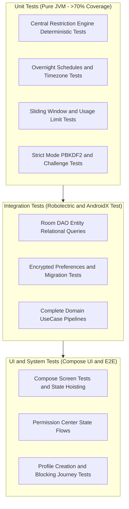

# Test Strategy & Quality Assurance Architecture

## 1. Testing Philosophy & Test Pyramid

**TakeBack** adheres to a disciplined software testing strategy modeled on the classic Testing Pyramid. Because this is a mission-critical utility where functional failures (false blocks or missed blocks) directly destroy user trust, testing rigor is prioritized across three distinct tiers:

---

## 2. Unit Testing Strategy: Zero Android Dependency Domain

The core restriction engine (`CentralRestrictionEngine`) and all time normalization algorithms are written in pure Kotlin standard library. This enables **instantaneous execution** of hundreds of boundary test cases in standard JVM test suites (`testDebugUnitTest`) without the overhead of Android emulator startup.

### Mandatory Unit Test Suites:
1. **Schedule Boundary Suite:**
   - Standard daytime schedule (before start, inside window, after end).
   - Overnight schedule (spanning 22:00 to 06:00, tested at 21:59, 22:00, 23:59, 00:00, 05:59, 06:00, 06:01).
   - Weekday bitmask filtering (active on MWF, inactive on TThSaSu).
2. **Usage Limit & Quota Suite:**
   - 0 minutes used $\rightarrow$ Allowed.
   - Limit - 1 second used $\rightarrow$ Allowed.
   - Exact limit used $\rightarrow$ Blocked.
   - Limit exceeded $\rightarrow$ Blocked.
   - Midnight reset rollover $\rightarrow$ Immediate re-allowance.
3. **Multi-Profile Conflict Suite:**
   - Two active profiles with disjoint blocklists (Union verification).
   - Two active profiles with conflicting limits (Minimum threshold verification).
   - Allowlist exception overriding active blocklist.
4. **Strict Mode Cryptography Suite:**
   - Correct PIN verification $\rightarrow$ True.
   - Incorrect PIN verification $\rightarrow$ False.
   - Constant-time string comparison to prevent timing attacks.
   - Challenge text exact validation (whitespace, case sensitivity).

---

## 3. Integration & Room Database Testing

Room DAO integration tests execute using in-memory databases (`Room.inMemoryDatabaseBuilder`) to verify:
- Foreign key cascade deletions (deleting a profile automatically cascades to its schedules, target apps, and limits).
- Complex query performance with indices.
- DataStore read/write contracts and encryption resilience.

---

## 4. Compose UI Component Testing

Compose UI tests leverage `createComposeRule()` to verify:
- UI state rendering for loading, content, and error states.
- Search filtering in the app picker list.
- Challenge input responsiveness and button enable/disable states.
- Accessibility semantics and TalkBack `contentDescription` properties.

---

## 5. Automated Regression & Continuous Validation

- **Build & CI Validation:** Continuous integration pipeline configured via `.github/workflows/android.yml` automatically executes `./gradlew test` and `./gradlew assembleDebug` on every push and pull request.
- **Unit Test Coverage:** 175 automated unit tests passing across pure domain evaluation, security exemption resolver, usage aggregators, strict mutation gate, and state persistence repositories (`PersistenceRepositoryTest.kt`).
- **Lint & Static Analysis:** Android Lint and Kotlin compiler warnings verified with zero compiler warnings across production code.
- **Performance Profiling:** Continuous monitoring of allocation in the restriction engine to guarantee zero garbage collection pauses during foreground app switches.
