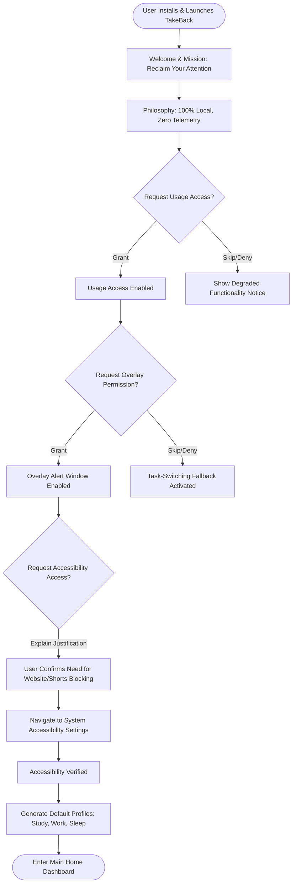
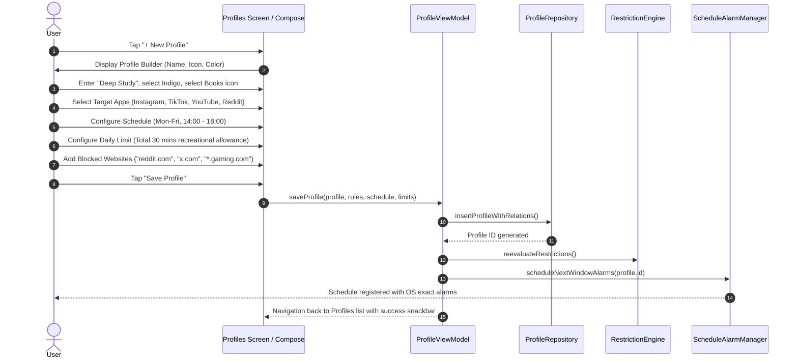
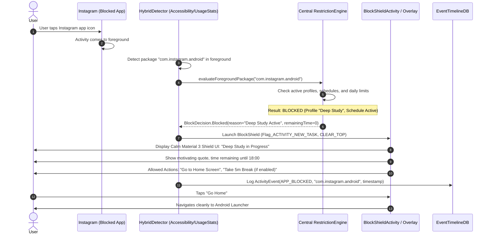
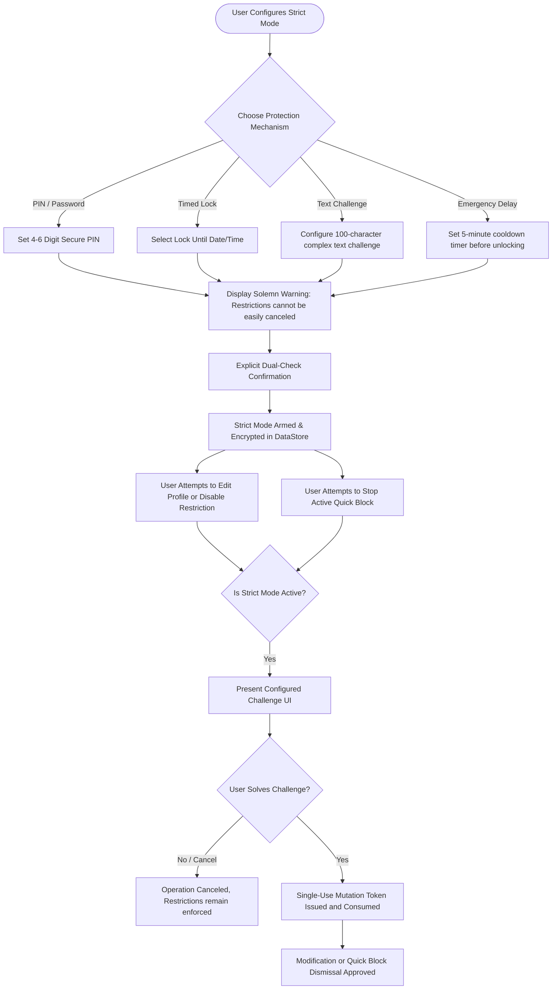
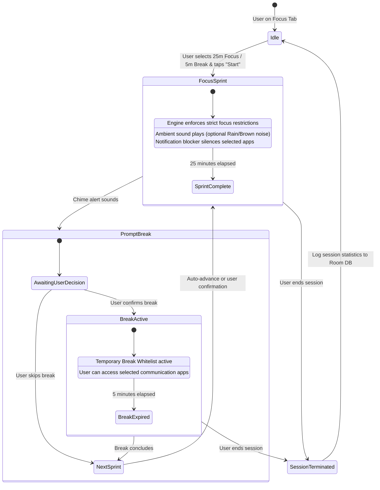
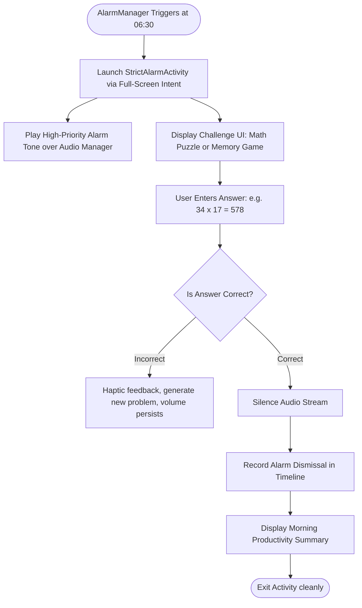

# User Workflows & Journey Architecture

This document defines the core user journeys, state transitions, interaction models, and edge-case recoveries for **TakeBack**.

---

## Workflow 1: First-Time Onboarding & Progressive Permission Escalation

### Key Principles of Onboarding:
1. **Never dump permissions all at once:** Permissions are grouped logically by capability.
2. **Usage Access is Tier 1:** Required for basic screen time analytics and app launch limits.
3. **Overlay Access is Tier 2:** Required for instantaneous, polite blocking shields over restricted apps.
4. **Accessibility is Tier 3:** Only requested if the user explicitly opts into website filtering or selective short-form video blocking.
5. **No Wall of Refusal:** If a user denies a permission, TakeBack gracefully disables only the affected sub-features, providing clear status pills in the Permission Center.

---

## Workflow 2: Creating a Restriction Profile (e.g. "Deep Study")

---

## Workflow 3: Application Blocking & Enforcement Interaction

---

## Workflow 4: Strict Mode Arming & Challenge-Based Unlocking

---

## Workflow 5: Pomodoro Focus Session & Take-a-Break Lifecycle

---

## Workflow 6: Strict Alarm Wake-Up Workflow

